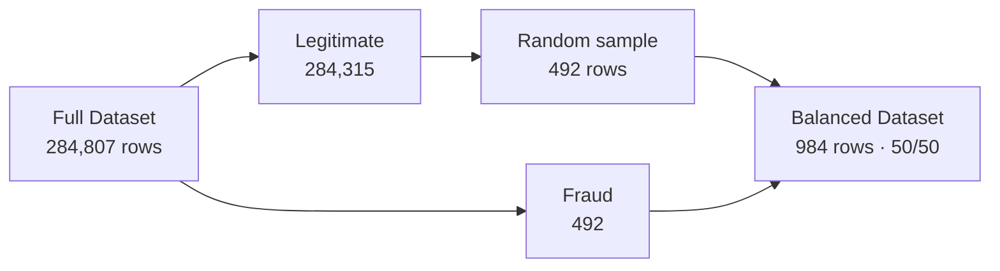
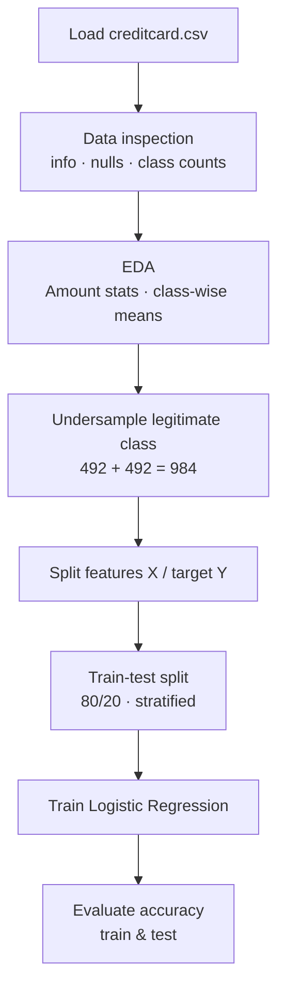

#  Credit Card Fraudulent Transaction Detection Model

A machine learning model that classifies credit card transactions as **legitimate** or **fraudulent**. The project tackles a heavily imbalanced dataset (only **0.17%** of transactions are fraud) using **random undersampling** and trains a **Logistic Regression** classifier.

---

##  Table of Contents
- [Overview](#-overview)
- [Dataset](#-dataset)
- [Exploratory Data Analysis](#-exploratory-data-analysis)
- [Handling Class Imbalance](#️-handling-class-imbalance)
- [Workflow](#-workflow)
- [Model & Results](#-model--results)
- [Project Structure](#-project-structure)
- [Installation & Usage](#-installation--usage)
- [Limitations](#️-limitations)
- [Future Work](#-future-work)


---

##  Overview

Credit card fraud costs banks and customers billions every year. Fraudulent transactions are rare, so a naive model can reach 99.8% accuracy by labelling *everything* as legitimate while catching zero fraud.

This project:
1. Explores the transaction data and compares legitimate vs. fraudulent transactions
2. Builds a **balanced dataset** through undersampling
3. Trains a **Logistic Regression** model to separate the two classes
4. Evaluates it on held-out test data

---

##  Dataset

**[Credit Card Fraud Detection, Kaggle (ULB Machine Learning Group)](https://www.kaggle.com/datasets/mlg-ulb/creditcardfraud)**

Transactions made by European cardholders over two days in September 2013.

| Property | Value |
|----------|-------|
| Total transactions | 284,807 |
| Features | 30 (+ 1 target) |
| Legitimate (Class 0) | 284,315 |
| Fraudulent (Class 1) | 492 |
| Fraud ratio | **~0.17%** |
| Missing values | None |

**Features**
| Column | Description |
|--------|-------------|
| `Time` | Seconds elapsed since the first transaction in the dataset |
| `V1`–`V28` | Anonymized features from a **PCA transformation** (originals hidden for confidentiality) |
| `Amount` | Transaction amount (USD) |
| `Class` | Target: `0` = Legitimate, `1` = Fraud |

>  The dataset (`creditcard.csv`, ~150 MB) is **not included** in this repo because of its size. Download it from Kaggle and place it in the project root.

---

##  Exploratory Data Analysis

### Transaction amount statistics

| Statistic | Legitimate | Fraudulent |
|-----------|-----------:|-----------:|
| Count | 284,315 | 492 |
| Mean | $88.29 | $122.21 |
| Std | $250.11 | $256.68 |
| Median | $22.00 | $9.25 |
| 75th percentile | $77.05 | $105.89 |
| Max | $25,691.16 | $2,125.87 |

**Key insights**
- Fraudulent transactions have a **higher mean** but a **lower median** amount. Many frauds are small "test" charges, plus a few large ones.
- The largest fraud ($2,125) is far below the largest legitimate transaction ($25,691).
- Class-wise means of the PCA features differ sharply (e.g. `V3`: 0.01 vs −7.03, `V7`: 0.01 vs −5.57, `V1`: 0.01 vs −4.77), which shows the features carry strong signal for separating fraud.

---

##  Handling Class Imbalance



**Random undersampling:** 492 legitimate transactions are randomly sampled to match the 492 fraud cases. The resulting **balanced dataset of 984 transactions** keeps the model from simply predicting the majority class.

After sampling, the class-wise feature means of the legitimate sample stay close to those of the full legitimate set, so the sample is representative.

---

##  Workflow



| Step | Details |
|------|---------|
| Train-test split | 80% train (787) / 20% test (197), `stratify=Y`, `random_state=2` |
| Model | `sklearn.linear_model.LogisticRegression` (default parameters) |
| Metric | Accuracy score |

---

##  Model & Results

| Dataset | Accuracy |
|---------|---------:|
| Training data | **93.77%** |
| Test data | **89.85%** |

The small gap between training and test accuracy indicates the model **generalizes reasonably well** without severe overfitting.

---

##  Project Structure

```
Credit-Card-Fraudulant-Transaction-Detection-Model/
│
├── Credit_Card_Fraud_Detection_using_Machine_Learning.ipynb   # Main notebook
├── requirements.txt
├── README.md
└── creditcard.csv        # Download from Kaggle (not tracked in git)
```

---

##  Installation & Usage

### 1. Clone the repository
```bash
git clone https://github.com/<your-username>/Credit-Card-Fraudulant-Transaction-Detection-Model.git
cd Credit-Card-Fraudulant-Transaction-Detection-Model
```

### 2. Install dependencies
```bash
pip install -r requirements.txt
```

### 3. Download the dataset
Download `creditcard.csv` from [Kaggle](https://www.kaggle.com/datasets/mlg-ulb/creditcardfraud) and place it in the project root.

### 4. Run the notebook
```bash
jupyter notebook Credit_Card_Fraud_Detection_using_Machine_Learning.ipynb
```
Run all cells from top to bottom.

---

##  Limitations

- **Accuracy alone is not enough for fraud detection.** Missing a fraud (false negative) costs far more than flagging a legit transaction, so **precision, recall, F1-score and ROC-AUC** are more meaningful.
- **Information loss from undersampling:** only 492 of 284,315 legitimate transactions are used, so ~99.8% of the legitimate data is discarded.
- **Evaluated on balanced data:** the test set is 50/50, but real-world traffic is ~0.17% fraud. Performance on the true distribution may differ.
- **No feature scaling:** `Time` and `Amount` are on very different scales from the PCA features `V1`–`V28`.
- **Random sample without a seed:** `legit.sample(n=492)` has no `random_state`, so results vary slightly between runs.

---

##  Future Work

- [ ] Add **confusion matrix, precision, recall, F1-score and ROC-AUC / PR-AUC**
- [ ] Scale `Time` and `Amount` with `StandardScaler` / `RobustScaler`
- [ ] Try **SMOTE** oversampling or `class_weight='balanced'` instead of discarding data
- [ ] Compare with **Random Forest, XGBoost, LightGBM** and **Isolation Forest / Autoencoders** (anomaly detection)
- [ ] Use **stratified K-fold cross-validation**
- [ ] Evaluate on the **original imbalanced test distribution**
- [ ] Tune the decision threshold for higher fraud recall
- [ ] Save the model with `joblib` and deploy it via **Streamlit / Flask**


